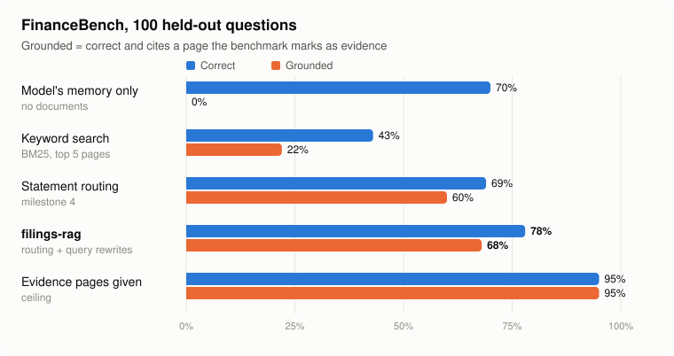

# filings-rag

Question answering over company filings (10-Ks, 10-Qs, earnings releases) where every figure cites the
page it came from. Measured on [FinanceBench](https://github.com/patronus-ai/financebench): 150 analyst
questions over 84 real filings, with a fixed dev/test split and a grader checked against human labels.

<picture>
  <source media="(prefers-color-scheme: dark)" srcset="docs/results-dark.svg">
  
</picture>

**On the 100 test questions, 78% of answers are correct and 68% are correct *and* cite a page the
benchmark marks as evidence.** Plain keyword search gets 43% and 22% (paired test p < 0.001). Claude
answering from memory gets 70% correct, a gap that is not statistically significant on 100 questions, but
cites nothing: 0% grounded. Memory also will not carry over to filings the model has never seen.

A real answer from the evaluation run (a dev-split question), unedited:

```text
Q: What is the FY2018 capital expenditure amount (in USD millions) for 3M? Give a response to the
   question by relying on the details shown in the cash flow statement.

A: 3M's FY2018 capital expenditure was $1,577 million. This is the line "Purchases of property, plant
   and equipment (PP&E)" in the cash flow statement, shown as an outflow of (1,577) [p. 60]. The same
   figure appears in the free cash flow reconciliation [p. 49] and as total company capital spending
   [p. 39].
```

## How it works

```text
PDF ──> parse tables ──> chunk ──> index (BM25 + local embeddings)
                                        │
question ──> route to statement ──┐     │
         └─> rewrite (Haiku) ─────┴──> search, re-rank, fuse ──> top 5 chunks ──> Claude answers with [p. N]
```

1. **Parse tables as tables.** PyMuPDF words are regrouped into rows and cells, so
   `Purchases of property, plant and equipment | (1,577) | (1,373) | (1,420)` survives, with its units
   ("in millions") and column years attached to the chunk. 90 of 90 line-item rows the benchmark relies
   on come through intact; plain text extraction keeps none.
2. **Route to the financial statement.** Many questions need the balance sheet, income statement or cash
   flow statement, and search kept returning notes that use the same words. A router reads which statement
   a question needs ("quick ratio" means the balance sheet, "capex" means cash flows), finds that
   statement in the filing by its title and position, and puts it first.
3. **Rewrite the question in the filing's words.** Analysts say "capex"; filings say "Purchases of
   property, plant and equipment". Claude Haiku writes three searches in filing language
   ($0.0125 for all 150 questions, cached).
4. **Search, re-rank and fuse.** Each search runs BM25 and dense retrieval
   (`bge-small-en-v1.5`, local, no API), a cross-encoder re-ranks the candidates, and the lists are
   fused by reciprocal rank, at most one chunk per page.
5. **Answer with citations, or decline.** Claude Opus answers from the top 5 chunks only (about 2,700
   input tokens), cites `[p. N]` for every figure, and says it cannot answer when the evidence is missing.

## How it is measured

- **A fixed split.** 50 dev questions for building and tuning, 100 test questions. Stratified by question
  type, and fixed by hash, so it never moves. The test set is not pristine; see Limits.
- **A grader checked against people.** An LLM judge labels each answer correct, incorrect or refusal.
  On 150 of the paper's human-labelled answers it had not seen during rubric design, it agrees with the
  human label 92% of the time (Cohen's kappa 0.88). Re-grading identical answers flips about 1 label in
  100, so differences of a point or two are judge noise.
- **Grounded accuracy.** Correct *and* citing an evidence page. This is the number that separates
  retrieval from memory.
- **Baselines.** Memory only (no documents), keyword search over whole pages, and the evidence pages
  handed over (the ceiling).
- **An audited answer key.** Three reference answers contradict their own working
  (`benchmark.py`); scores are reported with and without them.

## Results

| Test set, 100 questions | Correct | Grounded | Evidence page retrieved (top 5) | Cost per question |
| --- | ---: | ---: | ---: | ---: |
| Model's memory only | 70% | 0% | – | $0.020 |
| Keyword search, top 5 pages | 43% | 22% | 28% | $0.045 |
| Statement routing (milestone 4) | 69% | 60% | 73% | $0.026 |
| **filings-rag (milestone 5)** | **78%** | **68%** | **89%** | **$0.026** |
| Evidence pages given (ceiling) | 95% | 95% | 100% | $0.021 |

Paired McNemar tests on the same 100 questions (`filings-rag compare`), filings-rag against each row:

| Against | Correct: only filings-rag right / only the other right | p | Grounded: p |
| --- | ---: | ---: | ---: |
| Model's memory only | 17 / 9 | 0.17 | < 0.001 |
| Keyword search | 41 / 6 | < 0.001 | < 0.001 |
| Statement routing (milestone 4) | 14 / 5 | 0.064 | 0.13 |

Cost includes grading. Each milestone's write-up has dev and test scores, failure reviews and what did not
work:

| Milestone | What it covers |
| --- | --- |
| [1. Baselines](results/milestone-1/RESULTS.md) | Memory, keyword search and ceiling; judge validation |
| [2. Parsing](results/milestone-2/RESULTS.md) | Table-aware parsing and chunking: 95.8% of evidence text recovered |
| [3. Retrieval](results/milestone-3/RESULTS.md) | Dense, hybrid, re-ranking and statement routing |
| [4. Answering](results/milestone-4/RESULTS.md) | First end-to-end score; baselines re-graded |
| [5. Recall](results/milestone-5/RESULTS.md) | Correct statement pages, query rewriting, page diversity |

### What did not work

- **Hybrid search hurt.** Fusing BM25 with dense retrieval lowered evidence-page recall from 45% to 36%:
  questions use concepts and filings use line-item labels, so keyword ranking added noise.
- **Re-ranking alone was neutral** on the test set (milestone 3). It stays because plain dense search did
  worse as the fallback behind routing (dev recall 68% against 80%).
- **The first statement router had a bug.** It often picked a look-alike page (a reclassification table,
  a guarantor schedule, a subsidiary's statements in an exhibit). Milestone 3's write-up claimed full
  coverage; that claim was corrected in milestone 5, and the fix added 6 points of recall.

### Limits

- **One run per configuration, 100 test questions.** The gains over keyword search and the grounding gap
  over memory are significant; the correctness gains over memory and over milestone 4 are not yet (p 0.17
  and 0.064). Repeat runs are the next step.
- **The test set informed some decisions.** It was scored at milestones 1, 3, 4 and 5, and milestone 4's
  failure review read test answers, which shaped milestone 5. 43 of the 100 test questions share a filing
  with a dev question. No leak benefit is visible: evidence-page recall is 35 of 43 on those and 54 of 57
  on the rest. Failure reviews now use dev only, and a fresh evaluation set would settle it.
- **The filing is given,** as in the FinanceBench paper. Search across all 84 filings at once is built but
  not yet reported.
- **Grounding is a lower bound.** The benchmark marks one page per fact; filings repeat figures, so a
  correct citation to another page counts as ungrounded.
- **Reading is now the bottleneck.** When the evidence is retrieved, 80% of answers are right, against 95%
  when the model sees only the evidence pages. Most misses are definition choices (which quick-ratio
  formula), incomplete lists, or a committed wrong headline.

## Run it

Needs Python 3.12+ and an Anthropic API key for the answering and grading commands. Parsing, indexing and
retrieval evaluation run locally at no cost.

```bash
python -m venv .venv
source .venv/bin/activate                 # Windows: .venv\Scripts\activate
pip install -e ".[dev]"
filings-rag data                          # downloads the questions and 84 PDFs, verifies SHA-256 hashes
python -m pytest
```

```bash
python scripts/embed_all.py               # embeds 65k chunks on CPU, about an hour, once
filings-rag retrieval-eval --split test --methods routed,routed_rewrite          # free: rewrites ship with the code
export ANTHROPIC_API_KEY=...
filings-rag run --mode routed_rewrite --split all                                 # about $4
filings-rag validate-judge --seed 11 --exclude-seed 7                            # about $1, out of sample
filings-rag compare routed_rewrite_claude-opus-5-5_medium_all closed_book_claude-opus-5-5_medium_all  # free
python scripts/make_chart.py              # redraws the chart from results/
```

Runs are resumable: re-running a name skips questions already answered and graded. Each run writes
`runs/<name>/answers.jsonl` (answer, pages given, tokens, cost, latency), `grades.jsonl` and
`summary.json`.

## Layout

| Path | What it is |
| --- | --- |
| `src/filings_rag/parse.py`, `chunk.py` | Table-aware PDF parsing and chunking |
| `src/filings_rag/statements.py` | Finding the primary statements; routing questions to them |
| `src/filings_rag/rewrite.py` | Query rewriting with Claude Haiku |
| `src/filings_rag/retrieve.py` | BM25, dense, re-ranking, routing and fusion |
| `src/filings_rag/answer.py`, `judge.py` | Answer modes and the grading rubric |
| `src/filings_rag/runner.py` | Resumable runs, scoring, judge validation |
| `results/` | Every milestone's write-up and summary numbers |
| [`DESIGN.md`](DESIGN.md) | The plan written before building, and the decisions since |

## Next

- **An MCP server** so Claude, Cursor and other agents can search live SEC EDGAR filings and get passages
  with page citations.
- **Closing the reading gap:** whole statement pages for routed chunks, and stating the definition used
  for each ratio.
- **Open search** across all filings, and a repeat run for variance.

## Data and licence

The code is MIT licensed. The benchmark is not in this repository: `filings-rag data` downloads it from
the FinanceBench repository at a pinned commit. The Hugging Face copy of the dataset is licensed
[CC BY-NC 4.0](https://huggingface.co/datasets/PatronusAI/financebench), so results here are for
noncommercial research.

> Islam, P., Kannappan, A., Kiela, D., Qian, R., Scherrer, N., and Vidgen, B. (2023).
> FinanceBench: A New Benchmark for Financial Question Answering. arXiv:2311.11944.
